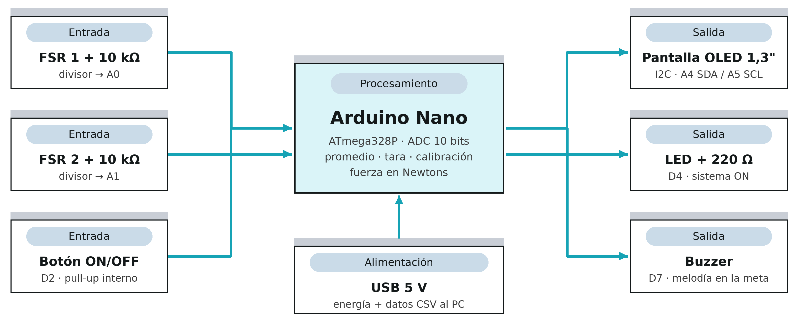

# RehaForce

Handgrip digital para medir la fuerza de agarre en ejercicios de rehabilitación de la mano.
Prototipo educativo (no clínico) · Electrónica para Ingeniería Biomédica · UDD
**Grupo 10:** Isidora Rodriguez · Verena Stolzenbach

## Estado y versión
**Versión presentada en la defensa final: `v1.2`** (etiqueta de git `v1.2`).

| Funciona | Pendiente |
|---|---|
| PCB fabricada en la universidad (cobre, una cara + puentes) | Calibración con referencia (balanza) — la tabla del firmware tiene valores de ejemplo |
| Lectura de 2 FSR, tara, máximo, meta | Montaje final en la caja impresa |
| Pantalla OLED, LED, buzzer con melodía, botón ON/OFF | Pruebas de repetibilidad |
| Registro de datos por USB (CSV) | Versión en Newtons (`v1.3`) en prueba |

## Arquitectura

| Elemento | Designador | Pin Arduino Nano |
|---|---|---|
| FSR 1 (+ R1 10 kΩ a GND) | J1 / R1 | A0 |
| FSR 2 (+ R2 10 kΩ a GND) | J2 / R2 | A1 |
| OLED 1,3" I2C (VDD, GND, SCK, SDA) | J3 | 5V, GND, A5, A4 |
| Botón ON/OFF | SW1 | D2 (pull-up interno) |
| LED + R3 220 Ω | D1 / R3 | D4 |
| Buzzer | BZ1 | D7 |

Archivos principales:
- Electrónica: [`electronica/kicad/`](electronica/kicad/) (esquemático y PCB), [`electronica/outputs/gerbers/`](electronica/outputs/gerbers/) (Gerber y taladros)
- Firmware: [`firmware/rehaforce_v1_2/`](firmware/rehaforce_v1_2/) (versión presentada), [`firmware/rehaforce_v1_3/`](firmware/rehaforce_v1_3/) (en Newtons), [`firmware/rehaforce_prueba/`](firmware/rehaforce_prueba/) (prueba por bloques)
- Mecánica: [`mecanica/`](mecanica/) (caja, tapa, barra, pernos en STL/STEP)
- Documentación: [`docs/`](docs/) (bitácora, informes, datasheets)

## Firmware
- **Placa:** Arduino Nano (ATmega328P). En clones: *Processor → ATmega328P (Old Bootloader)*.
- **Herramientas:** Arduino IDE 2.x.
- **Dependencias:** librería **U8g2** (by oliver) — *Herramientas → Administrar bibliotecas → "U8g2"*.
- **Configuración** (al inicio del `.ino`): `META` / `META_N` (meta de fuerza) y la tabla `CAL_CRUDO` / `CAL_GRAMOS` (calibración).

Pasos para compilar y cargar:
1. Abrir `firmware/rehaforce_v1_2/rehaforce_v1_2.ino`.
2. Elegir placa **Arduino Nano** y el puerto USB.
3. Verificar (✓) y Subir (→).

## Software
No se requiere aplicación externa: toda la lógica corre en el microcontrolador. Opcionalmente, el **Serial Plotter** del Arduino IDE (115200 baudios) muestra la curva, y los datos CSV (`tiempo_ms,crudo,gramos,maximo,meta`) se pueden copiar a Excel.

## Comprobación inicial
1. Conectar el USB: la pantalla muestra **"RehaForce – Apagado"**.
2. Pulsar el botón **sin apretar el handgrip**: pitido corto, **LED encendido** y tara automática (fuerza ≈ 0).
3. Apretar la barra: la fuerza y la barra de progreso suben en la pantalla.
4. Al llegar a la meta: aparece **"OK!"** y suena la melodía.
5. Pulsar de nuevo el botón: dos pitidos, LED apagado.

Si algo no responde, cargar `firmware/rehaforce_prueba` para revisar cada bloque.

## Licencia
MIT (ver `LICENSE`).
